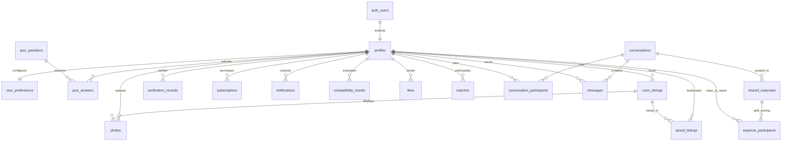

# YAARO – SYSTEM ARCHITECTURE SPECIFICATION (PHASE 1)

**Brand Name**: YAARO  
**Tagline**: *Find your people. Find your place.*  
**Mission**: Shared-living platform combining roommate discovery, compatibility matching, room listings, shared expenses, and community for Indian youth.

---

## 1. Executive Summary & Brand Identity

YAARO is purpose-built to solve the fragmentation and friction of urban co-living in India (Bengaluru, Mumbai, Delhi NCR, Pune, Hyderabad). The platform combines five interconnected pillars into one coherent ecosystem:

1. **Roommate Discovery**: Verified profiles with genuine lifestyle badges (dietary, sleep schedule, work style).
2. **Compatibility Engine**: 7-point living compatibility algorithm measuring cleanliness, night-owl schedules, guests, and kitchen habits.
3. **Verified Room Marketplace**: 0% brokerage room listings with transparent deposits (capped at 2 months) and virtual tours.
4. **Shared Expense Ledger**: Splitwise-grade flatmate expense tracker with integrated UPI settlement and landlord rent payment receipts.
5. **Community & Culture**: House rules agreements, chore matrices, and neighbourhood co-living circles.

### Brand Personality & Visual Language
* **Tone**: Indian youth-oriented, modern, welcoming, tech-forward, and trustworthy.
* **Primary Color (Tech Indigo)**: `#4F46E5` — Trust, security, digital foundation.
* **Secondary Color (Tangerine Coral)**: `#F97316` — Warmth, friendship, social connection.
* **Accent Color (Emerald Green)**: `#10B981` — Verified ID status, high compatibility matches, settled payments.
* **Neutral Palette**: Slate `#0F172A` (text), Slate `#F8FAFC` (backgrounds), Card surfaces `#FFFFFF`.
* **Typography**: **Plus Jakarta Sans** for display/headlines; **Inter** for clean, readable body copy.
* **Corner Radius**: `12px` (ROUND_TWELVE) for approachable, rounded card surfaces.

---

## 2. Stitch MCP Design System & Screen Inventory

All visual screens were designed and generated in Stitch MCP under Project `11845095055014692370` using design system `assets/14398776751853535949`.

| Screen Flow | Stitch Screen ID | Key UI Elements |
| :--- | :--- | :--- |
| **1. Landing Page** | `caf5e5ab89224c409dae2f3726856f57` | Hero with value proposition, dual search (Flatmates vs Rooms), city chips, budget slider, 5 feature cards, live social proof ticker, persistent bottom nav. |
| **2. Login & Onboarding** | `8150b1056d0e47de90a848c32b1bd6e1` | +91 phone auth, OTP auto-read, Google OAuth, DigiLocker trust badge, 4-step wizard, living preference selector (3 options), lifestyle tag cloud. |
| **3. Roommate Discovery & Match** | `81598b0734ac4f7186d2bf9deea1ff14` | Hero profile card, `🔥 96% Match` badge, 7-point harmony radar, work/college verification badges, audio vibe note player, quick icebreakers, match action bar. |
| **4. Compatibility Games & Quiz** | `20f4c1ead2fc44b6bb7dae264c7aa692` | Interactive questions (e.g. sink dishes rule), selected state rings, 92% harmony dial, category progress meters, potential friction points alert. |
| **5. Room Marketplace & Listing** | `0a527b5a6e0d4384a242f541d26ede8e` | Map/List toggle, 0% brokerage badge, fair deposit callout (2-month cap), flatmate compatibility preview, amenities grid, visit scheduler, post room FAB. |
| **6. Flatmate Chat & Agreements** | `6dfc034228f84521a6dfdb40ab507d7f` | Room discussion banner, 'Draft Flatmate Agreement' button, system match notice, video tour card attachment, quick prompt chips, secure composer. |
| **7. Shared Expenses & Ledger** | `3212352002cb4e459a72913051d39f85` | Net balance card ('+₹3,850 owed to you'), 1-tap UPI settle (GPay/PhonePe), monthly expense progress bar, Blinkit/Maid/Wi-Fi itemized feed, Rent Splitter. |

---

## 3. Application Architecture

```
                    ┌──────────────────────────────────────────┐
                    │            Client Application            │
                    │   (PWA / Responsive Mobile-First Web)    │
                    └─────────────────────┬────────────────────┘
                                          │ HTTPS / WSS
                                          ▼
                    ┌──────────────────────────────────────────┐
                    │          Next.js 14 App Router           │
                    │  ┌───────────────────┐ ┌──────────────┐  │
                    │  │ Server Components │ │ Client Views │  │
                    │  └─────────┬─────────┘ └──────┬───────┘  │
                    │            │ Server Actions   │          │
                    │            ▼                  ▼          │
                    │     Edge Middleware (Session Refresh)    │
                    └─────────────────────┬────────────────────┘
                                          │
                  ┌───────────────────────┴───────────────────────┐
                  ▼                                               ▼
    ┌───────────────────────────┐                   ┌───────────────────────────┐
    │   Supabase Auth & RLS     │                   │  Supabase Storage (CDN)   │
    │  - Phone OTP / Google     │                   │  - avatars                │
    │  - 19 Tables with RLS     │                   │  - listing-photos         │
    │  - Realtime WebSocket     │                   │  - verification-docs      │
    └───────────────────────────┘                   └───────────────────────────┘
```

### Folder Structure
```
Roomie/
├── docs/
│   └── architecture/
│       └── PHASE_1_ARCHITECTURE.md
├── public/
│   ├── favicon.ico
│   └── icons/
├── src/
│   ├── app/
│   │   ├── (auth)/
│   │   │   ├── login/
│   │   │   └── onboarding/
│   │   ├── (dashboard)/
│   │   │   ├── discover/
│   │   │   ├── rooms/
│   │   │   ├── matches/
│   │   │   ├── expenses/
│   │   │   └── community/
│   │   ├── globals.css
│   │   ├── layout.tsx
│   │   ├── manifest.ts
│   │   └── page.tsx
│   ├── components/
│   │   ├── ui/               # Reusable primitives (Button, Card, Badge, Modal, Input)
│   │   ├── layout/           # Header, BottomNav, MobileDrawer
│   │   ├── discovery/        # MatchCard, HarmonyRadar, TagCloud
│   │   ├── rooms/            # ListingCard, AmenitiesGrid, VisitScheduler
│   │   ├── expenses/         # LedgerCard, SplitModal, UPISettlement
│   │   └── chat/             # MessageBubble, AgreementCard, VideoPreview
│   ├── lib/
│   │   ├── supabase/
│   │   │   ├── client.ts     # Browser client (@supabase/ssr)
│   │   │   ├── server.ts     # Server client with cookies (@supabase/ssr)
│   │   │   └── middleware.ts # Edge session updater
│   │   └── utils.ts          # cn, currency formatters
│   ├── types/
│   │   ├── database.ts       # Full 19-table schema types
│   │   └── index.ts
│   └── middleware.ts         # Edge routing middleware
├── supabase/
│   └── migrations/
│       ├── 20261124000000_init_yaaro_schema.sql
│       └── 20261124000001_phase1_complete_schema.sql
├── package.json
├── pnpm-lock.yaml
├── postcss.config.mjs
├── tailwind.config.ts
└── tsconfig.json
```

---

## 4. Database Schema (19 Tables)

The database schema is implemented with foreign-key constraints, enum checks, and performance indexes in [20261124000001_phase1_complete_schema.sql](file:///c:/Users/shelk/Desktop/Roomie/supabase/migrations/20261124000001_phase1_complete_schema.sql).

### Entity Relationship Overview



### Table Definitions Summary
1. **`profiles`**: User identity, age, gender, occupation, college/company, location, budget range, verification tier.
2. **`user_preferences`**: Preferred cities/localities, room type (private/shared), dietary habits, pet/smoking/drinking tolerance.
3. **`photos`**: Profile photos, lifestyle shots, and room photography with verification tags and ordering.
4. **`quiz_questions`**: 12–15 curated lifestyle questions covering cleanliness, sleep, guests, chores, and expenses.
5. **`quiz_answers`**: User responses with user-weighted importance (1–5 scale).
6. **`compatibility_results`**: Pre-calculated pairwise harmony scores (0–100%) with dimension breakdowns.
7. **`likes`**: Swipe actions (roommate like, pass, super vibe, listing bookmarks).
8. **`matches`**: Mutual roommate matches with connection status.
9. **`conversations`**: Direct chats and flatmate group channels.
10. **`conversation_participants`**: Membership, unread tracking, and mute toggles.
11. **`messages`**: Real-time chat messages, audio vibe notes, video tours, agreements, and payment requests.
12. **`room_listings`**: Verified room marketplace listings (0% brokerage, 2-month deposit limit, amenities).
13. **`saved_listings`**: User wishlist/bookmarked listings.
14. **`shared_expenses`**: Flat group expense records (rent, cook/maid, groceries, Wi-Fi, electricity).
15. **`expense_participants`**: Individual member balances, settlement flags, and UPI transaction references.
16. **`verification_records`**: Aadhaar/DigiLocker, work email, and college ID verification logs.
17. **`subscriptions`**: Freemium and YAARO Pro status.
18. **`notifications`**: In-app notifications for matches, messages, expenses, and visits.
19. **`reports_and_blocks`**: Safety reporting, spam detection, disguised broker prevention, and user blocking.

---

## 5. Security-First Row Level Security (RLS) Strategy

Every table has Row Level Security enabled (`ALTER TABLE ... ENABLE ROW LEVEL SECURITY`).

* **Zero-Trust Defaults**: Deny all operations unless explicitly permitted by policy.
* **Profiles**:
  * Publicly readable only if `is_profile_public = true` (excluding sensitive verification data).
  * Update/Insert restricted to `auth.uid() = id`.
* **Conversations & Messages**:
  * Scoped strictly via `conversation_participants`. Non-members cannot read or emit messages.
* **Shared Expenses & Ledgers**:
  * Only confirmed flat group members can view or record expenses.
* **Room Listings**:
  * Publicly readable for active/available rooms. Mutated only by the verified host.
* **Verification & Government IDs**:
  * Verification records and raw document metadata are never exposed in public queries; only the derived `verification_tier` badge is visible on the profile.

---

## 6. API, Authentication & Storage Strategy

### API & Data Access Strategy
* **Next.js Server Actions**: Form submissions, profile updates, and expense creations are handled via typed Server Actions with Zod validation.
* **Supabase Realtime**:
  * Active channels for real-time messaging (`messages` table listener).
  * Live updates for flat expense settlements and incoming match notifications.

### Authentication Strategy
1. **Primary**: Phone number OTP via SMS (standard pattern for Indian mobile users).
2. **Alternative**: Google OAuth with automated email verification.
3. **Verification Tiering**:
   * *Tier 0*: Unverified (Browsing only).
   * *Tier 1*: Phone Verified (Can take quiz and browse).
   * *Tier 2*: Workplace / College Email Verified (Unlocks direct chat).
   * *Tier 3*: DigiLocker / Aadhaar Verified (Full badge, priority ranking, room posting).

### Storage Buckets & Policies
* **`avatars`** (Public read, authenticated upload up to 5MB, JPG/PNG/WebP).
* **`listing-photos`** (Public read, host upload up to 15MB, includes 1080p short video walkthroughs).
* **`expense-receipts`** (Flat group access only, up to 10MB).
* **`verification-docs`** (Private, encrypted, admin/system access only).
